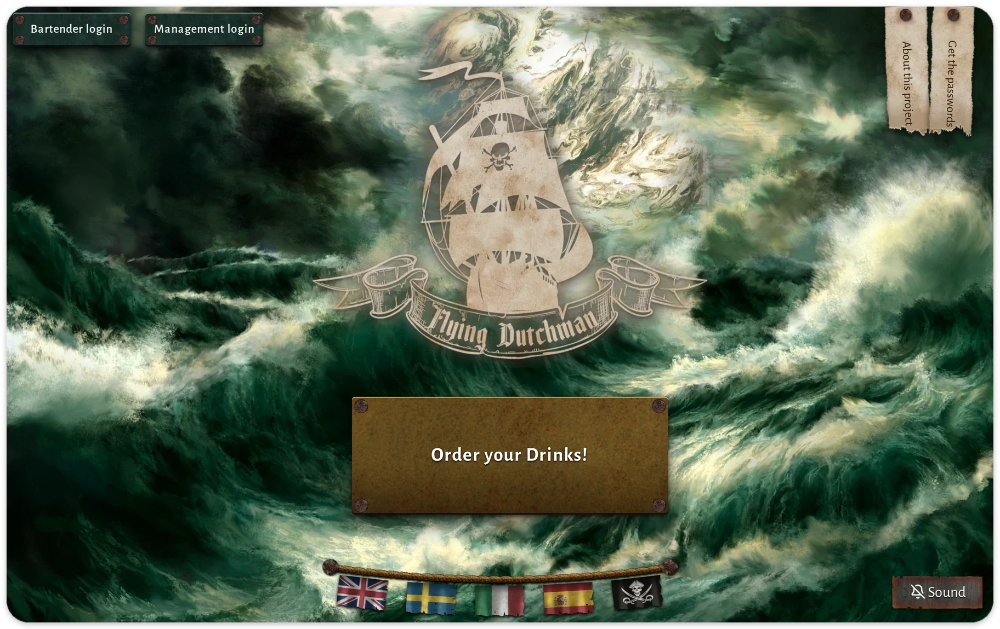
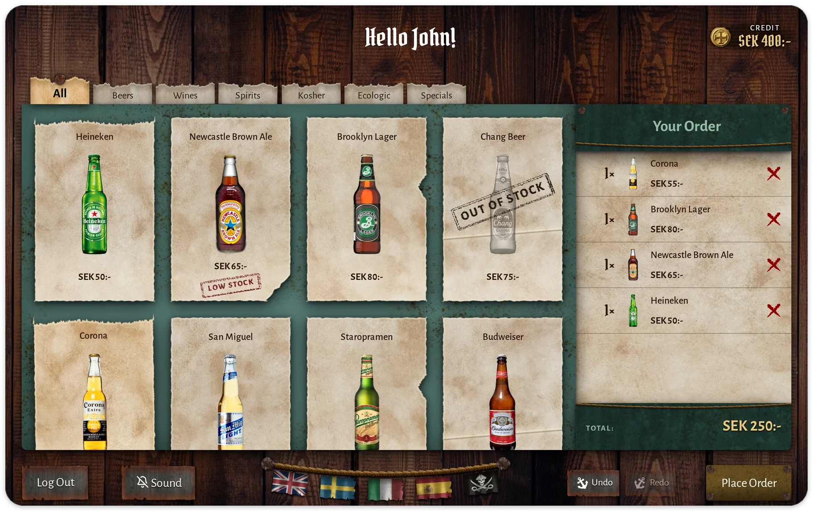
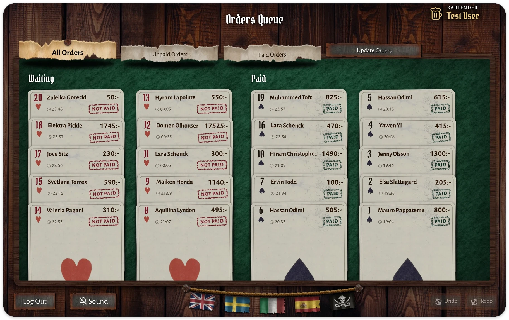
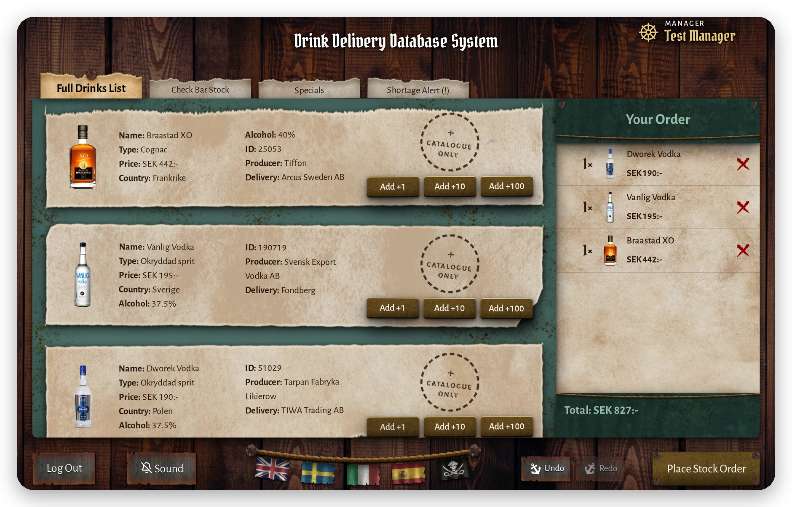
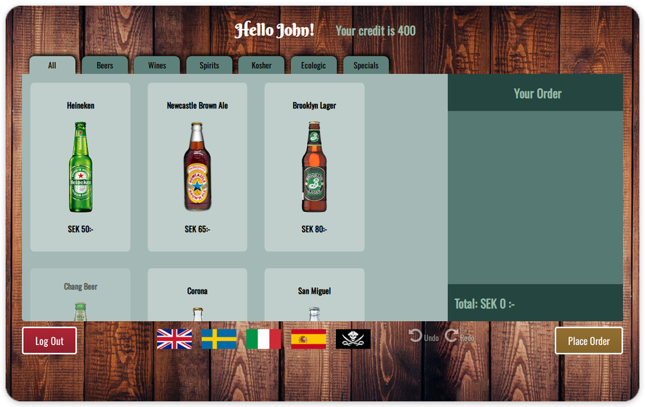
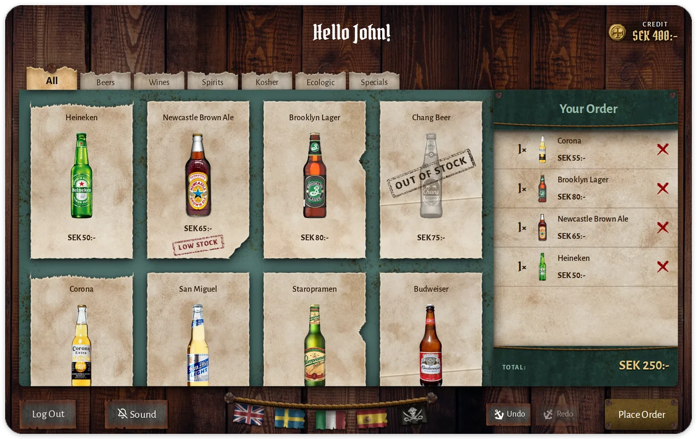
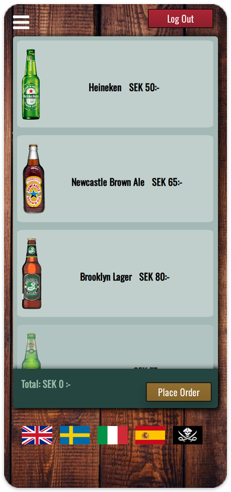
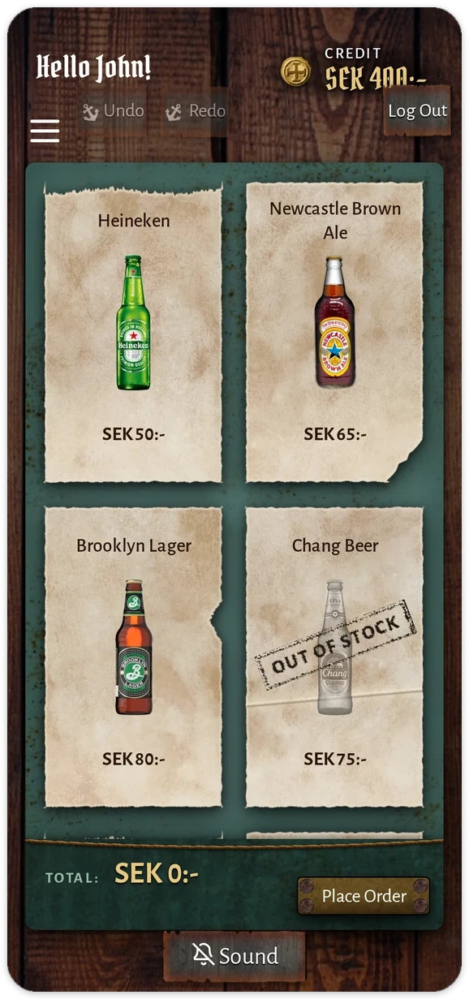

<div align="center">

# The Flying Dutchman · v2

**A pirate-bar ordering system, rebuilt for keyboards, screen readers and phones.**

**Version 2 · designed, directed and tested by [Hassan Odimi](https://TODO-hassan-odimi.se)**


<a href="https://the-flying-dutchman.hassan-odimi.workers.dev/"></a>

**[Live demo](https://the-flying-dutchman.hassan-odimi.workers.dev/)** &nbsp;·&nbsp; [Case study](https://TODO-hassan-odimi.se)

</div>

## At a glance

<table align="center">
  <tr>
    <td align="center"><b>587 to 0</b><br>accessibility<br>violations</td>
    <td align="center"><b>320 px</b><br>smallest screen,<br>no sideways scroll</td>
    <td align="center"><b>5</b><br>languages,<br>pirate included</td>
    <td align="center"><b>480</b><br>automated<br>test runs</td>
  </tr>
</table>

## Three roles, one ship

<p align="center"><b>Customer</b> · browse, order, pay with credit<br></p>

<p align="center"><b>Bartender</b> · serve the queue, mark orders paid<br></p>

<p align="center"><b>Manager</b> · restock, manage specials<br></p>

## Before and after

<table align="center">
  <tr>
    <th align="center">v1 · 2018</th>
    <th align="center">v2 · 2026</th>
  </tr>
  <tr>
    <td align="center"></td>
    <td align="center"></td>
  </tr>
  <tr>
    <td align="center"></td>
    <td align="center"></td>
  </tr>
</table>

## What I changed

| Area | Result |
|---|---|
| **Accessible** | You can order, serve and restock by keyboard alone. Screen readers announce each change to the order with its new total. 0 axe violations in all 4 views. |
| **Phone-ready** | The manager view had no viewport tag, so phones shrank it to 0.38×. It now fits 320 px. Touch targets are 24 px or more. |
| **Themed** | 143 hard-coded colours became named colour tokens. Wood, parchment, rope and brass textures replace the flat panels. |
| **Feedback** | 11 `alert()` pop-ups became toasts and live regions. |
| **Haunted** | Fog, wind and ghost effects with sound cues. Sound is off by default. Reduced motion gets plain fades. |
| **Tested** | 234 Playwright tests in Chromium and Firefox, plus 12 phone tests, with axe and a virtual screen reader. |

## Try it

```bash
python3 -m http.server 8080   # open http://localhost:8080
```

Open **Get the passwords** on the landing page for demo logins. To run the tests:

```bash
npm install && npx playwright install && npm test
```

## Credits

- **v2 (2026):** Hassan Odimi. Design, polish, tests and docs.
- **v1 (2018):** Hassan Odimi, Mauro José Pappaterra, Jenny Olsson, Yawen Yi and Elsa Slättegård, for Interface Design I at Uppsala University.

[Design system](DESIGN.md) · [Audit numbers](docs/audit-baseline.md) · [Asset licences](docs/ASSETS.md)
